# RAG Assistant over a French Literary Corpus

Academic Retrieval-Augmented Generation (RAG) and Information Retrieval project developed at the Université de Technologie de Compiègne in Spring 2026 by Santiago Avellaneda Rodriguez, Iago Rhudá Ramos, and Kenza Fadouache.

The project combines semantic retrieval over a long French literary corpus with grounded answer generation through the Gemini API. It does not train, fine-tune, or redistribute a language model. The embeddings are produced locally with a pretrained multilingual sentence-transformer, while Gemini is used as an external generation and evaluation service.

Important: the Harry Potter novels are not distributed with the public repository. Users must provide their own legally obtained source PDFs.

## Project Overview

The application answers questions over the seven French Harry Potter novels. This is a harder retrieval setting than short encyclopedic documents because relevant information in narrative text can span multiple passages, depend on small details, be split by chunk boundaries, or fail to rank among the top retrieved chunks.

The repository contains two complementary paths:

- RAG / semantic retrieval path: PDF loading, chunking, multilingual embeddings, ChromaDB retrieval, MMR diversification, Gemini generation, source display, and LLM-based faithfulness/relevance auditing.
- Classical Information Retrieval path: PDF-to-XML processing, tokenization, stopword handling, French stemming, inverted indexes, Boolean and metadata queries, BM25-inspired ranking, and Levenshtein spell correction.

The classical search engine originated from previous LO17 TD/course work and was adapted/integrated into this final application. It is a complementary baseline/search tab, not a newly invented component built entirely from scratch for the final RAG project.

## Architecture

```mermaid
flowchart LR
    A[User-provided PDFs] --> B[PDF loader]
    B --> C[RecursiveCharacterTextSplitter]
    C --> D[Local multilingual embeddings]
    D --> E[Persistent ChromaDB]
    E --> F[MMR retriever]
    F --> G[Retrieved context + source metadata]
    G --> H[Gemini generation]
    H --> I[Answer + visible sources]
    I --> J[LLM-based faithfulness / relevance audit]
```



The application is served through Streamlit (`app.py`). At startup, it can build both the classical indexes and the RAG vector database from the PDFs present in `data/input/`.

The RAG and classical IR paths share the same local PDF corpus but are not fused in the current implementation: classical search results are not injected into the RAG prompt.

## RAG Pipeline

Verified implementation details:

- PDF loading with `PyPDFLoader` in `src/RAG/loader_pdf.py`.
- Chunking with `RecursiveCharacterTextSplitter`.
- Local embeddings with `sentence-transformers/paraphrase-multilingual-MiniLM-L12-v2` through `langchain-huggingface`.
- Persistent ChromaDB vector storage in cosine space.
- MMR retrieval through LangChain's Chroma retriever.
- Prompt construction that includes source name and page metadata for each retrieved chunk.
- Gemini generation through `ChatGoogleGenerativeAI`.
- Streamlit display of retrieved source snippets.
- LLM-as-a-judge audit for faithfulness to retrieved context and answer relevance.

The default generation temperature in code is `0.2`, and the Streamlit sidebar lets the user choose among configured Gemini model names and adjust temperature.

## Retrieval Configuration

The retained configuration in the code/report is:

- Chunk size: `2500` characters
- Chunk overlap: `500` characters
- Embedding model: `sentence-transformers/paraphrase-multilingual-MiniLM-L12-v2`
- Vector store: ChromaDB with cosine space
- Retrieval: MMR (`search_type="mmr"`)
- `k = 12`
- `fetch_k = 50`

MMR was used to reduce redundant retrieved passages and improve diversity among candidate chunks. Several chunking/retrieval configurations were tried, and this setup was retained because it worked best overall in qualitative testing. This is not a benchmarked accuracy result.

## Corpus

The final report records the following corpus inspection figures:

- 7 French novels
- 2,709 PDF pages inspected
- 2,697 pages with extractable text
- Approximately 7.24 million characters

The novels themselves must not be published in this repository unless redistribution rights are explicitly verified. Users must place their own legally obtained PDFs in `data/input/` before running the app.

Persisted ChromaDB indexes and generated XML/index files may contain derived representations or extracted text from the novels. They should also be reviewed carefully and normally excluded from a public repository.

## Evaluation

What exists:

- Retrieved source chunks are shown to the user.
- The team performed qualitative testing across several chunking/retrieval configurations.
- `src/RAG/evaluation.py` implements an LLM-as-a-judge audit for faithfulness and answer relevance.
- `src/research_engine/evaluation.py` contains an experimental classical-IR evaluation script, but its manually curated ground truth is incomplete unless an external `ground_truth.json` is provided.

Benchmark status:

- An individual follow-up retrieval benchmark now evaluates 42 answerable questions from 45 owner-approved questions, using AI-authored evidence labels that were not independently checked page by page by the owner.
- MMR flat Recall@12 is **0.250 [0.137, 0.375]**; cosine is **0.294 [0.173, 0.425]** (95% question-bootstrap intervals). The production BM25-inspired pipeline scores zero, largely because its boolean prefilter returns no candidates.
- Full methodology, category results, evidence-need coverage and limitations: [retrieval benchmark results](eval/RESULTS.md). This work was completed individually after the team project.
- Generation accuracy and faithfulness have not been benchmarked.
- The LLM-judge scores shown in the Streamlit UI are runtime diagnostic signals, not defensible benchmark performance metrics.

The final system worked end-to-end in practical tests, but exact or very broad narrative questions can still fail when useful information is split across chunks or does not rank highly enough.

## Retrieval Experiments and Key Learning

The main engineering lesson was that RAG quality was often limited by retrieval rather than generation. When the right passages were retrieved, Gemini could usually produce a coherent answer. Failures were often caused by missing, overly broad, or poorly ranked context.

Observed retrieval challenges included:

- Fixed-size chunk boundaries splitting narrative details.
- Redundant passages when using pure similarity retrieval.
- Exact questions depending on rare details or names.
- Broad questions requiring context from several distant passages.
- Long-form novels being harder to retrieve from than short, self-contained documents.

The final report notes that the team was congratulated during the oral presentation for its use of MMR; this should be understood as presentation feedback, not as an award or quantitative validation.

## Classical Information Retrieval

The complementary classical engine is located under `src/research_engine/` and exposed to the Streamlit UI through `src/search_adapters/search_bridge.py`.

Verified components include:

- PDF parsing into a structured XML corpus.
- Tokenization and stopword handling.
- French stemming with NLTK Snowball stemming.
- TF, DF, and IDF-related statistics.
- Inverted indexes by fields such as text, date, author, and rubric.
- Boolean query handling and metadata/date filters.
- BM25-inspired ranking with TF saturation and IDF smoothing.
- Levenshtein-based spelling correction over the generated lexicon.

This engine is useful for exact or structured search and as a fallback when the Gemini-backed RAG path is unavailable.

## Tech Stack

- Python
- Streamlit
- LangChain
- ChromaDB
- Hugging Face / sentence-transformers
- Google Gemini API (`langchain-google-genai`)
- `pypdf`
- NLTK
- `lxml`
- NumPy / Matplotlib for classical IR evaluation utilities

## Repository Structure

```text
.
├── app.py                         # Streamlit application entry point
├── src/
│   ├── RAG/                       # PDF loading, vectorstore, RAG chain, LLM-based audit
│   ├── research_engine/           # Classical LO17 information retrieval engine
│   └── search_adapters/           # Adapter between Streamlit and classical engine
├── data/
│   ├── input/                     # User-provided PDFs; should not contain public copyrighted PDFs
│   └── output/                    # Generated XML, indexes, vectorstores, evaluation outputs
├── requirements.txt               # pip dependency list
├── environment.yml                # Conda environment file; see installation note below
├── .env.example                   # Example Gemini API key configuration
└── README.md
```

## Installation

Python 3.11 is used in `environment.yml`.

Recommended pip setup:

```bash
python -m venv .venv
source .venv/bin/activate
pip install -r requirements.txt
```

Conda setup from the existing environment file:

```bash
conda env create -f environment.yml
conda activate rag
```

The Conda file mirrors the RAG runtime dependencies from `requirements.txt` through its `pip:` section.

## Configuration

Gemini generation and LLM-based evaluation require a Google API key. Create a local `.env` file from `.env.example`:

```env
GOOGLE_API_KEY=your_gemini_api_key_here
```

Never commit `.env` or real API keys. The app also allows entering the key through the Streamlit sidebar.

## Usage

1. Place legally obtained source PDFs in `data/input/`.
2. Configure `GOOGLE_API_KEY` if you want to use the RAG assistant.
3. Start the Streamlit application:

```bash
streamlit run app.py
```

On first launch, the app asks which available PDFs to index. It then builds the classical XML/index files and, if a Gemini API key is available, the local ChromaDB vector store.

If the RAG path fails because of a missing/invalid key, quota, or network issue, the classical search tab can still be used.

## Data and Copyright

This repository should not publicly distribute copyrighted novels, extracted novel text, generated XML containing novel text, or persisted vector indexes derived from copyrighted text unless redistribution rights are explicitly verified.

Before publishing to GitHub, remove tracked copyrighted corpus files from Git and verify that generated outputs are not included. `.gitignore` helps prevent future accidental additions but does not remove files that are already tracked.

## Limitations

- Academic prototype, not a production AI system.
- No model training or fine-tuning.
- Retrieval benchmark evidence is AI-authored/AI-checked; owner approval covers question selection and wording, not independent verification of every evidence page.
- Retrieval settings were selected through qualitative testing; the later frozen benchmark measures that configuration without tuning against its results.
- Retrieval is sensitive to chunk boundaries and ranking.
- Exact or broad narrative questions can fail when relevant passages are missing from the retrieved context.
- External Gemini dependency for generation and LLM-based evaluation.
- API quotas, connectivity, model availability, and prompt-following can affect results.
- LLM-as-a-judge scores are diagnostic and can be biased, especially when using the same provider family for generation and evaluation.
- The current RAG chain treats each question independently and does not pass conversation history to the model.

## Team and Contributions

Three-person UTC academic project, Spring 2026:

- Santiago Avellaneda Rodriguez
- Iago Rhudá Ramos
- Kenza Fadouache

The final report records equal overall participation among the three team members. Repository/code work was collaborative, and commits were made through Iago's university GitLab account, so Git commit authorship should not be used as an exclusive indicator of technical contribution.

Santiago confirms direct collaborative work across the RAG pipeline, including PDF/document loading, chunking, embeddings, ChromaDB/vector retrieval, MMR retrieval, Gemini prompting/chain integration, Streamlit integration, and automated faithfulness/relevance evaluation.

## Academic Context

Université de Technologie de Compiègne, Spring 2026. The final report uses LO17-AI31 as the project context.
